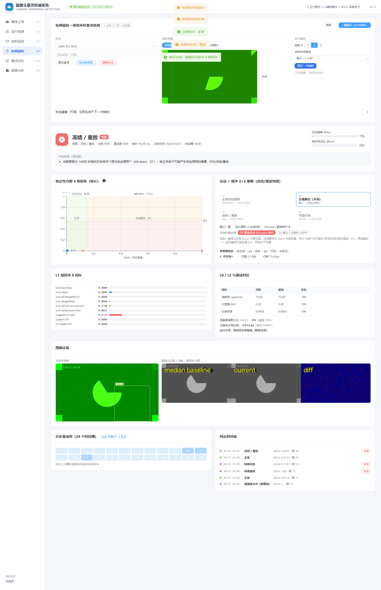

# 摄像头篡改检测 · 低频巡检

> [!WARNING]
> **默认无鉴权：不配置 `APP_AUTH_TOKEN` 时，后端对 `/api/**` 一律放行（fail-open），
> 启动日志会打印告警。此时任何能访问到 8080 的人都能删除机位、清空基线、改参照物。
> 部署到公网、或任何非受信网络之前，必须配置 `APP_AUTH_TOKEN`。**
> 详见 [docs/DEPLOY.md §5 鉴权配置](docs/DEPLOY.md)。

面向监控摄像头的**低频巡检**篡改检测：不实时拉流，每 1 小时（可配到 1 天）拉一次帧、
每次连拉 3 帧，用「与历史基线的偏离 × 微时序动态」判断画面是否被篡改。

成本约为实时方案的 **1/1500 ~ 1/18000**，纯 CPU 运行，不需要 GPU、不需要深度学习模型。

覆盖攻击：**遮挡 / 失焦 / 移位·转动 / 冻结·重放 / 画面替换**。



---

## 目录

- [它解决什么问题](#它解决什么问题)
- [能力清单](#能力清单)
- [架构](#架构)
- [目录结构](#目录结构)
- [快速开始](#快速开始)
- [本地 / 服务器两种跑法](#本地--服务器两种跑法)
- [配置服务器连接](#配置服务器连接)
- [页面使用指南](#页面使用指南)
- [算法概要](#算法概要)
- [接口一览](#接口一览)
- [自测](#自测)
- [常见问题](#常见问题)
- [已知边界](#已知边界)
- [文档](#文档)

---

## 它解决什么问题

监控摄像头被遮挡、转向、贴纸、替换录像，是安防里最常见的攻击。传统做法要么依赖
持续拉流（成本高），要么只看短时突变（无法识别**长期持续**的篡改）。

本系统针对**固定机位、低频采样**场景：

| 约束 | 我们的选择 |
|---|---|
| 不能实时拉流 | 1 小时拉一次，每次 K=3 帧（几秒的微序列） |
| 看不到篡改过程 | 用「历史偏离 × 微时序动态」4 格矩阵，把**持续篡改**与**有人路过的瞬时事件**分开 |
| 昼夜光照变化 | 24 个时段槽各自维护基线，自动吸收光照差异 |
| 天气变化误报 | 全局光度对齐（变暗/变灰不算篡改） |
| 场景内物体移动 | 忽略区 + 局部变化降级（不告警） |
| 参照物被遮挡/换季 | 子块投票 + 多模板库（人工补录夜间/雨天模板） |

---

## 能力清单

| 能力 | 说明 |
|---|---|
| 抽样判定 | 1~12 帧/次，返回结论 + 三层信号 + 证据图 + 原因链 |
| **24 时段槽基线** | 按小时分槽、每槽最多 8 样本，逐像素中位数背景 + MAD |
| **稳定性分解** | `dHist × dBurst` 4 格矩阵，区分持续篡改与瞬时事件 |
| **冻结/重放检测** | 跨采样点逐位相同 + 帧间时间噪声缺失 |
| **参照物标定** | 多尺度全幅匹配 + 峰值唯一性 + 相似变换拟合（平移/旋转/缩放） |
| **子块投票** | 3×3 子块共识，抗"车停在参照物中间"这类部分遮挡 |
| **模板库** | 每个参照物可存多套外观模板（夜间/雨天/换季），匹配取最高分 |
| **忽略区** | 圈出会被频繁挪动的区域，不参与基线偏离统计 |
| 光度对齐 | 整体变暗/变灰自动对齐，不误报 |
| 证据可视化 | 关键帧 / 基线中位数 / 差异热力图 / 2×2 象限 / 4 格矩阵 / 24 槽画廊 / 时间线 |
| 审计 | 模板增删记录时间、操作人、来源、当时判定结论 |

---

## 架构

```
浏览器（Vue3 + Element Plus + ECharts）
        │  REST / multipart
        ▼
SpringBoot 3（只做透传与校验，不持有业务状态）
        │  HTTP（JSON + multipart）
        ▼
Python FastAPI（低频巡检算法层，纯 CPU）
        │  机位基线按 cameraId 落盘（JSON + NPZ）
        ▼
algo/data/sparse/
```

**设计要点**

- **后端不做算法**：所有判定只在 Python 实现一份，避免双语言逻辑漂移；
- **状态在算法层**：两次抽样间隔 1 小时，进程内状态必然过期，所以基线与参照物按机位落盘；
- **后端无数据库**：不引入 JPA/H2，减少攻击面与运维负担；
- **纯 CPU**：单次抽样约 50ms（960×540），一台普通机器可跑很多机位。

---

## 目录结构

```
camera-tamper-demo/
├── algo/                        # Python 算法层
│   ├── server.py                # FastAPI 入口（只暴露 /sparse/*）
│   ├── sparse/                  # ★ 低频巡检核心
│   │   ├── metrics.py           #   底层指标：单帧 / 微时序 / 鲁棒 z / 参照物匹配
│   │   ├── store.py             #   机位态、基线库、模板库、审计
│   │   └── engine.py            #   判定流程与结果组装
│   ├── media.py                 # 图片解码
│   ├── requirements.txt
│   └── tests/test_sparse.py     # 算法行为回归自测（用例数随代码演进）
├── backend/                     # SpringBoot 3（透传层）
│   └── src/main/java/com/demo/tamper/
│       ├── controller/SparseController.java
│       ├── controller/AlgoController.java   # 仅 /health
│       └── service/{SparseService,AlgoGatewayService}.java
├── frontend/                    # Vue3 + TS
│   └── src/{api,views/SparseView.vue,router,store}
├── deploy/                      # 远端部署 + SSH 隧道
├── docs/                        # 文档与截图
├── start_all.bat / start_all.sh # 一键启动
└── samples/                     # 演示样本
```

---

## 快速开始

### 前置要求

| 依赖 | 版本 |
|---|---|
| JDK | 17+ |
| Maven | 3.8+ |
| Node.js | 18+ |
| Python | 3.10+ |

端口：算法层 `8000`（本地）或 `18010`（隧道）、后端 `8080`、前端 `5173`。

### ⚠️ 首次克隆请先读这一段

从 git 拉下来后，**有四件事会让人卡住**，都不是 bug：

| 坑 | 现象 | 解决 |
|---|---|---|
| **JDK 版本** | `mvn` 报 `release 17 not supported` | 本机若默认 JDK 11，先设 `JAVA_HOME` 指向 JDK 17 |
| **前端依赖** | `npm run test` 报找不到 vitest | 必须先 `cd frontend && npm install` |
| **Python 编码** | 跑测试时报 `UnicodeEncodeError: gbk` | 设 `PYTHONIOENCODING=utf-8` |
| **鉴权默认关闭** | 不配 token 也能访问，以为漏了校验 | 这是**故意的** fail-open，见下方「鉴权」一节 |

```powershell
# Windows 示例：JDK 版本 + Python 编码
$env:JAVA_HOME = "C:\Program Files\Java\jdk-17"
$env:PYTHONIOENCODING = "utf-8"
```

### 本地跑（推荐，零依赖服务器）

```bash
cd algo
python -m venv .venv
.venv\Scripts\pip install -r requirements.txt      # Windows
# .venv/bin/pip install -r requirements.txt        # Linux / macOS
cd ..

start_all.bat          # Windows
./start_all.sh         # Linux / macOS
```

打开 http://localhost:5173 即可。**不需要 GPU、不需要 YOLO、不需要服务器**。

### 鉴权（默认关闭，部署公网前必须打开）

后端的 `/api/**` 支持令牌校验，由 `app.auth.token` 控制：

- **不配置 = 放行**（fail-open），启动日志会打一条 WARN。这是为了让 demo 开箱即用，**不是遗漏**。
- 配置后（环境变量 `APP_AUTH_TOKEN` 或 `application.yml` 的 `app.auth.token`），请求需带
  `Authorization: Bearer <token>`（主用）或 `X-API-Token: <token>`（别名）。
- 校验失败返回 `401`，响应体沿用 `ApiResponse` 结构。

> **部署到公网前必须配置 `APP_AUTH_TOKEN`，并让算法层只监听 `127.0.0.1`。**
> 详见 `docs/DEPLOY.md` §5。

### 跑测试

> 三端测试都需要先完成依赖安装（`pip install -r requirements.txt` / `npm install`）。
> Windows 下**必须设 `PYTHONIOENCODING=utf-8`**，否则算法层测试会在输出
> `⇒` 字符时抛 `UnicodeEncodeError: gbk`。

```powershell
$env:JAVA_HOME       = "C:\Program Files\Java\jdk-17"
$env:PYTHONIOENCODING = "utf-8"

# 算法层 —— 59 项断言，确定性合成画面，可复现
cd algo
.venv\Scripts\python.exe tests\test_sparse.py

# 后端 —— 45 项断言：鉴权 / 租户 / URI 编码 / 错误映射
cd backend
mvn test

# 前端 —— Vitest
cd frontend
npm install
npm run test
```

期望结果：算法层 `全部通过`、后端 `Tests run: 45, Failures: 0, Errors: 0`、
前端 `Tests ... passed`。**任何一项有失败都不要提交**，测试是行为契约。

> 演示不需要摄像头，也不需要准备图片：点「一键演示」时会自动使用内置样图
> （`frontend/public/demo/reference_normal.jpg`）。

### 手动启动（三条命令，推荐用于排查）

> ⚠️ **PowerShell 用户请注意**：`-D` 开头的 Maven 属性必须**整体加双引号**，
> 否则 PowerShell 会在 `.` 处拆参，报 `Unknown lifecycle phase`。
> 下面的写法已经加好引号，直接复制即可。

```powershell
# 前置：JDK 版本（不设会用系统默认，很可能是 JDK 11 而编译失败）
$env:JAVA_HOME = "C:\Program Files\Java\jdk-17"

# ① 算法层（先起，后端依赖它）
cd algo
$env:PYTHONIOENCODING = "utf-8"
.venv\Scripts\python.exe server.py --host 127.0.0.1 --port 8000

# ② 后端（新开一个终端）
cd backend
mvn -DskipTests spring-boot:run "-Dspring-boot.run.arguments=--server.port=8080"

# ③ 前端（新开一个终端）
cd frontend
npm install
npm run dev
```

**端口被占用怎么办？** 后端换端口，前端通过 `VITE_API_TARGET` 跟着改：

```powershell
# 后端改用 8081
mvn -DskipTests spring-boot:run "-Dspring-boot.run.arguments=--server.port=8081"

# 前端指向 8081
$env:VITE_API_TARGET = "http://127.0.0.1:8081"
npm run dev
```

---

## 本地 / 服务器两种跑法

两种模式下**功能完全一致**（抽样、标定、忽略区、模板库、24 槽画廊、时间线、重设基准都可用），
区别只是算法层跑在哪。

| | 本地模式 | 服务器模式 |
|---|---|---|
| 启动 | 不加参数 | `start_all.bat --gpu` / `./start_all.sh --gpu` |
| 算法层地址 | `127.0.0.1:8000` | 经 SSH 隧道到 `127.0.0.1:18010` |
| 需要什么 | 只要本机 | 服务器 SSH 权限 + 写权限 |
| 适用 | 演示、单机验证 | 多人共享、算力集中 |

后端连哪个地址由启动脚本通过环境变量 `APP_ALGO_BASEURL` 自动设置，
**不需要手改 `application.yml`**。

### 服务器模式

```bash
# 1) 配置连接
cp deploy/.env.local.example deploy/.env.local
#   填 CTD_SSH_HOST / CTD_SSH_USER / CTD_SSH_KEY

# 2) 启动（会打包 algo/ 上传、重启远端服务、建隧道）
start_all.bat --gpu
```

> `--gpu` 会**重启远端服务**，需要 `CTD_REMOTE_ROOT`（默认 `/root/yzn_model_api`）的写权限。
> 服务已在跑时只想连过去：`python deploy/remote.py --tunnel`。

---

## 配置服务器连接

连接信息不进代码仓库，通过环境变量或本地文件提供（优先级：环境变量 > `.env.local`）。

| 变量 | 默认 | 说明 |
|---|---|---|
| `CTD_SSH_HOST` | **必填** | 服务器地址 |
| `CTD_SSH_USER` | `root` | 登录账号 |
| `CTD_SSH_KEY` | `~/.ssh/id_ed25519` | 私钥（存在则优先） |
| `CTD_SSH_PASSWORD` | 空 | 密码（无密钥时使用） |
| `CTD_REMOTE_ROOT` | `/root/yzn_model_api` | 远端部署目录 |

```bash
cp deploy/.env.local.example deploy/.env.local   # 然后填写
```

`deploy/.env.local` 已在 `.gitignore` 中，不会提交。

---

## 页面使用指南

只有一个页面：**低频巡检**（`/sparse`）。

### 1. 填机位 id

任意字符串（如 `cam-01`）。基线、参照物、模板库都按它落盘，换 id 就是换一个机位。

### 2. 选采样来源

| 来源 | 用途 |
|---|---|
| 摄像头 | 接本机摄像头实时抓帧（演示/验证） |
| 视频抽帧 | 从上传的视频里抽 K 帧 |
| 上传图片 | 直接用已有图片 |

选好后点「取当前画面」/「抓一帧」，再点「提交抽样」。

### 3. 看判定

右侧会给出：结论、风险、置信度、**原因链**（每条判据都写清楚）、
**4 格矩阵**（当前点落在哪个象限）、**三层信号**（L2/L1/L0 指标）、
**证据图**（关键帧 / 基线中位数 / 差异热力图）、**24 时段槽**、**时间线**。

### 4. 标定参照物（强烈建议）

点「标定参照物」→ 在画面上框 2~4 个**不会移动**的硬结构（大门、楼角、围墙、灯杆）。
作用：把"机位是否被移动/转动"的判定从"全图相位相关"换成"这些结构是否符合同一个刚体变换"，
大幅降低树影、行人、车辆造成的误报。

勾选「把这张画面同时加入历史基线」可以省掉一次抽样（会先过质量闸）。

### 5. 画忽略区

同一对话框里切到「忽略区」模式，圈出会被频繁挪动的区域（桌面、货架、门口堆放点）。
这些像素完全不参与基线偏离统计。

### 6. 模板库（夜间/雨天/换季）

标定后，参照物可能有多个外观模板：

- 在主界面「参照物模板库」里填名称、点「用当前画面补录」；
- 或在判定结果里点「**这不是篡改 · 加为参照物模板**」（误报反馈）。

有质量闸与去重；强制添加会被写入审计。

### 7. 一键演示

点「一键演示（6 次采样）」，30 秒跑完：正常 → 遮挡 → 失焦 → 重放，直接看到四种结论。

---

## 算法概要

### 三层信号

| 层 | 时间尺度 | 回答 |
|---|---|---|
| **L2 单帧** | 任意一帧 | 这一帧好不好（失焦/遮挡/画质） |
| **L1 微时序** | 一次抽样内 3 帧 | 这几秒画面动没动、是不是真摄像头 |
| **L0 跨采样点** | 相邻抽样间隔 | 跟本机位历史比有没有变 |

### 稳定性分解（核心）

```
dHist  = 与同时段基线的逐像素鲁棒 z 均值（归一化）
dBurst = burst 内的微时序动态
```

|  | 静止 | 有动态 |
|---|---|---|
| **偏离高** | **持续篡改（告警）** | 瞬时事件（不告警） |
| **偏离低** | 正常 | 正常活动 |

### 判决类型

`normal` / `cold_start` / `information_insufficient` / `transient_event` /
`object_change` / `freeze_replay` / `persistent_covered` / `persistent_defocused` /
`persistent_moved` / `persistent_change` / `being_rotated` / `no_signal`

详细公式、参数与判定细则见 [docs/SPARSE.md](docs/SPARSE.md)。

---

## 接口一览

后端统一返回 `{ code, message, data }`。

| 方法 | 路径 | 说明 |
|---|---|---|
| GET | `/api/algo/health` | 算法层健康状态 |
| GET | `/api/sparse/meta` | 参数元数据 + 判决字典 |
| POST | `/api/sparse/sample` | **提交一次抽样（1~12 帧）** |
| GET | `/api/sparse/cameras` | 机位列表 |
| GET | `/api/sparse/state/{cameraId}` | 机位状态（24 槽 + 历史 + 模板 + 审计） |
| POST | `/api/sparse/state/{cameraId}/reset` | 重设基准（保留参照物） |
| DELETE | `/api/sparse/state/{cameraId}` | 删除机位 |
| GET | `/api/sparse/thumb/{cameraId}/{slot}/{index}` | 基线样本缩略图 |
| POST | `/api/sparse/landmarks/{cameraId}` | 标定参照物 / 忽略区 |
| GET | `/api/sparse/landmarks/{cameraId}` | 查询参照物 |
| DELETE | `/api/sparse/landmarks/{cameraId}` | 清除参照物 |
| GET | `/api/sparse/landmarks/{cameraId}/templates` | 模板库 + 审计 |
| POST | `/api/sparse/landmarks/{cameraId}/templates` | 补录一套模板 |
| DELETE | `/api/sparse/landmarks/{cameraId}/templates/{tid}` | 删除模板 |
| GET | `/api/sparse/templates/{cameraId}/{tid}/preview` | 模板预览图 |

完整字段语义见 [docs/API.md](docs/API.md)。

**公共约定**

| 约定 | 说明 |
|---|---|
| 鉴权 | 配了 `APP_AUTH_TOKEN` 时，请求需带令牌；**未配置时放行并打告警**（fail-open） |
| 租户 | 请求头 `X-Tenant-Id`，缺省 `default`；后端拼成 `{tenant}:{cameraId}` 再调算法层 |
| 服务端时间 | 响应头 `X-Server-Now`（毫秒时间戳），前端在缺 `tsMs` 时用它兜底 |

字段与取值细节（含鉴权失败的状态码）见 [docs/API.md](docs/API.md)。

---

## 自测

```powershell
cd algo
$env:PYTHONIOENCODING='utf-8'; .\.venv\Scripts\python.exe tests\test_sparse.py
```

> Windows 控制台默认 GBK，脚本里的中文断言信息会触发 `UnicodeEncodeError`，
> 所以必须先设 `PYTHONIOENCODING=utf-8`（Linux / macOS 一般不需要）。

覆盖：基线累积 / 遮挡 / 失焦 / 跨采样点重放 / 合规静态不误报 / 正在转动 /
瞬时事件 / 曝光不稳 / 持久化 / 时段槽 / 移位 / 纸遮挡 / 光照变化 / 部分遮挡 /
模板库 / 质量闸 / 去重审计。

预期：末尾汇总行显示 `失败 0`（形如 `通过 N / N 全部通过`）。
总用例数会随代码演进增加，**不要把它当成固定契约**；作为行为契约的是「零失败」——
改动的判据如果推翻了既有行为，测试必须先失败、再讨论该不该改。

---

## 常见问题

**1. 页面显示「算法服务离线」**
先查算法层：`curl http://127.0.0.1:8000/health`（本地模式）或
`curl http://127.0.0.1:18010/health`（服务器模式）。

**2. 端口 8080 被占用**
Windows 上常见 `WinError 10013`（端口保留）或别的服务占用。
换端口启动并用环境变量告诉前端：

```powershell
cd backend
mvn -DskipTests spring-boot:run "-Dspring-boot.run.arguments=--server.port=8090"

# 另开终端
cd frontend
$env:VITE_API_TARGET="http://127.0.0.1:8090"; npm run dev
```

**3. `pip install` 慢或被墙**
启动脚本已经默认走阿里云镜像，首次建 `.venv` 时会打印 `pip index: …`。
要换成别的源或回退官方源：

```bash
PIP_INDEX_URL=https://pypi.tuna.tsinghua.edu.cn/simple ./start_all.sh   # 指定源
PIP_INDEX_URL=https://pypi.org/simple ./start_all.sh                    # 官方源
CTD_PIP_OFFICIAL=1 ./start_all.sh                                       # 同上，一键回退
```

```bat
set PIP_INDEX_URL=https://pypi.org/simple
start_all.bat
```

手动安装时同样可用：`pip install -i <源> -r requirements.txt`（实测清华的 wheel 下载可能 403）。

**4. 一直「基线建立中」**
正常。同一时段槽要攒 3 个样本（= 3 天）才算就绪；期间只记录、不下结论。

**5. 服务器模式的隧道反复「认证被拒」**
服务器对认证有频率限制。**等 1~2 分钟**再重试，优先用 SSH 密钥而不是密码。

---

## 已知边界

| 边界 | 说明 |
|---|---|
| 告警延迟下界 = 采样相位 | 1 小时采样平均延迟 30 分钟 |
| 瞬时事件必然漏检 | 3 秒遮挡落在抽样窗口的概率仅 0.28%~0.42% |
| 冷启动约 3 天 | 同一时段需 3 个样本 |
| 缓慢攻击可能被学进基线 | 每天变化都在阈值以下时会随基线漂移 |
| 假定固定机位 | 手持/云台场景不适用参照物方案 |
| 鉴权默认关闭 | 不配 `APP_AUTH_TOKEN` 时 fail-open（放行 + 启动告警），见顶部风险声明 |
| 租户隔离是逻辑隔离 | `X-Tenant-Id` 只做 `{tenant}:{cameraId}` 前缀隔离，不是安全边界；真正的边界是 `APP_AUTH_TOKEN` |
| 演示级并发 | 单进程单 worker，基线按机位落盘；机位数上千后的瓶颈与演进见 [docs/DEPLOY.md](docs/DEPLOY.md) |
| 不做 AIGC 画面检测 | 现有检测器在该场景不可靠，不作承诺 |

---

## 文档

| 文档 | 内容 |
|---|---|
| [docs/SPARSE.md](docs/SPARSE.md) | **低频巡检算法细节**：三层信号、稳定性分解、参照物与模板库、参数 |
| [docs/API.md](docs/API.md) | 接口契约与字段语义 |
| [docs/DEPLOY.md](docs/DEPLOY.md) | 部署与运维（本地 / SSH 隧道） |
| [docs/SOLUTION.docx](docs/SOLUTION.docx) | 完整技术方案（可汇报版） |

> 文档里的仓库地址：`https://github.com/GetUpAtEight/camera_detection`

---

## License

未指定。如需商用请先与作者确认。
